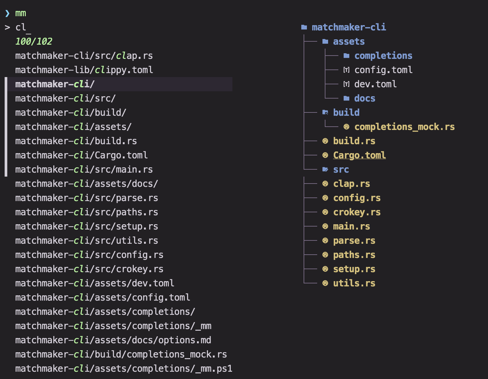

# Getting started

Matchmaker (`mm`) is a terminal fuzzy finder and workflow runner. It filters streams of text or command output across multiple columns, renders live text and image previews, and binds keys and events to shell or Lua actions.

## Install

Prebuilt binaries are published for Linux (`x86_64` and `aarch64` static `musl`), macOS (`x86_64` and `aarch64`), and Windows (`x86_64`).

Run the install script on Linux or macOS to detect your platform, download the latest release archive, and place `mm` in `~/.cargo/bin` (when present on `PATH`) or `~/.local/bin` (invoking `sudo` only if the target directory is not writable):

```shell
curl -fsSL https://raw.githubusercontent.com/Squirreljetpack/matchmaker/main/install.sh | sh
```

On Windows, run the PowerShell installer:

```powershell
powershell -ExecutionPolicy Bypass -c "irm https://github.com/Squirreljetpack/matchmaker/releases/latest/download/matchmaker-cli-installer.ps1 | iex"
```

Or install `mm` through a package manager:

```shell
# Homebrew
brew install Squirreljetpack/tap/matchmaker

# Arch Linux (AUR)
yay -S matchmaker-bin

# npm
npm install -g @squirreljetpack/matchmaker

# Cargo
cargo install matchmaker-cli
```

<details>
<summary>Optional runtime tools and editor/pager detection</summary>

`mm` runs without external runtime dependencies, falling back to `find` and `cat` on Unix or `Get-ChildItem` and `Get-Content` on Windows. Installing common CLI utilities upgrades the default file discovery, preview, and image commands:

| Tool | Role |
| --- | --- |
| `fd` | Default file discovery command (`fd --strip-cwd-prefix --print0`) |
| `bat` | Syntax-highlighted file previews and default `$PAGER` fallback |
| `eza` | Directory tree previews (`eza --color=always -T -L 2`) |
| `chafa` | Terminal image fallback when `mm --image` cannot decode a file natively |

When `$EDITOR` or `$PAGER` is unset in your environment, `mm` automatically selects an installed editor (`hx`, `nvim`, `vim`, `vi`, `nano`, or `notepad` on Windows) and pager (`bat`, `less`, `more`, or `cat`).

</details>

## First run

Pipe any line-delimited stream into `mm`, or run `mm` directly in a terminal to execute the configured `start.command` (which recursively lists files in the current directory):

```shell
find . | mm
mm
```



- **Filter** — Type into the query prompt to fuzzy-rank matching rows.
- **Select** — Move the cursor with `up` and `down`, toggle multi-selection on rows with `tab`, and press `enter` to print the accepted selection to standard output.
- **Preview** — Cycle preview layouts with `alt-/` or toggle the preview pane with `?`.

See [Input and data sources](/input-and-data), [Queries](/queries), and [Preview](/preview) for details on populating rows, filtering columns, and controlling the preview pane.

## Core keybindings

The default configuration pairs built-in navigation with semantic aliases (`@accept`, `@open`, `@reload`, `@copy`, `@help`). Expand the table below for the full default keymap, or press `alt-h` inside `mm` to inspect active bindings at any time.

<details>
<summary>Default keybindings by category</summary>

**Accepting and exiting**

| Keys | Action | Section |
| --- | --- | --- |
| `enter` | Accept current or selected rows (`@accept`) | [Binds](/binds) |
| `alt-enter` | Secondary accept (`@return`) | [Creating presets](/creating-presets#binds-traces-and-semantic-aliases) |
| `esc` / `ctrl-c` | Quit with exit code `1` (`Quit(1)`) | [Other](/other#exit-codes) |

**Selection and navigation**

| Keys | Action | Section |
| --- | --- | --- |
| `up` / `down` | Move cursor one row | [Binds](/binds#navigation) |
| `pageup` / `pagedown` | Scroll half a page up or down | [Binds](/binds#navigation) |
| `alt-1` / `alt-0` | Jump to first (`Pos(0)`) or last (`Pos(-1)`) row | [Binds](/binds#navigation) |
| `tab` / `shift-backtab` | Toggle row selection and move down or up | [Binds](/binds#selection) |
| `ctrl-a` / `ctrl-shift-a` | Cycle all selections or clear selections | [Binds](/binds#selection) |

**Columns, scrolling, and sorting**

| Keys | Action | Section |
| --- | --- | --- |
| `alt-.` / `alt-shift-.` | Focus next or previous column | [Queries](/queries#active-column-focus) |
| `alt-\` / `alt-shift-\` | Hide active column or restore hidden column | [Queries](/queries#visibility-widths-and-scrolling) |
| `alt-left` / `alt-right` | Scroll result cells horizontally (`HScroll`) | [Queries](/queries#visibility-widths-and-scrolling) |
| `alt-up` / `alt-down` | Scroll inside multi-line result rows (`VScroll`) | [Queries](/queries#visibility-widths-and-scrolling) |
| `alt-w` | Toggle result and header line wrapping | [Queries](/queries#visibility-widths-and-scrolling) |
| `alt-s` / `alt-n` / `alt-r` | Lexicographic sort, numeric sort, or reverse order | [Queries](/queries#sorting-results) |

**Preview and pager**

| Keys | Action | Section |
| --- | --- | --- |
| `?` | Toggle preview pane visibility | [Preview](/preview#preview-layouts-and-cycling) |
| `alt-/` / `alt-shift-/` | Cycle next or previous preview layout | [Preview](/preview#preview-layouts-and-cycling) |
| `shift-pageup` / `shift-pagedown` | Scroll preview half a page up or down | [Preview](/preview#scrolling-sticky-headers-and-jumping) |
| `ctrl-j` | Jump between end, top, and previous preview position | [Preview](/preview#scrolling-sticky-headers-and-jumping) |
| `ctrl-l` | Open preview output in fullscreen pager (`ShowPreview`) | [Pager](/pager) |

**Commands and help**

| Keys | Action | Section |
| --- | --- | --- |
| `ctrl-o` / `alt-o` | Open in `$EDITOR` (`@open`) or replace `mm` (`@open_2`) | [Execute](/execute) |
| `ctrl-r` | Reload input command (`@reload`) | [Input and data sources](/input-and-data#reloading-and-multiple-commands) |
| `alt-[` / `alt-]` | Previous or next command / preset (`@prev` / `@next`) | [Using presets](/using-presets#in-picker-help-and-navigation) |
| `ctrl-y` / `alt-p` | Copy to clipboard (`@copy`) or print to stdout (`@print`) | [Binds](/binds) |
| `alt-h` | Show live keymap in preview (`Help`) | [Preview](/preview#ad-hoc-commands-and-fullscreen-paging) |
| `F1` | Page preset `README.md` and resolved keymap (`@help`) | [Using presets](/using-presets#in-picker-help-and-navigation) |

</details>

Run `mm --test-keys` to inspect how your terminal reports key combinations, and see [Binds](/binds) (or `mm --doc binds`) for the complete trigger, event, mode, and action reference.

## Configuration

`mm` loads its base configuration file from the first matching location:

- The path passed to `--config <PATH>`
- `$MATCHMAKER_CONFIG_DIR/config.toml` (when `$MATCHMAKER_CONFIG_DIR` is set and the directory exists)
- `~/.config/matchmaker/config.toml` (when `~/.config/matchmaker` exists)
- `{PLATFORM_CONFIG_DIR}/matchmaker/config.toml` (such as `~/.config/matchmaker/config.toml` on Linux, `~/Library/Application Support/matchmaker/config.toml` on macOS, or `%APPDATA%\matchmaker\config.toml` on Windows)

Run `mm --dump-config` in an interactive terminal to write the commented default `config.toml` to disk if it does not already exist. When standard output is piped, `--dump-config` prints the active, merged configuration (including any `-o` preset or CLI overrides) to standard output instead:

```shell
# Write the default config.toml to disk
mm --dump-config

# Inspect the resolved configuration on stdout
mm --dump-config | cat
```

Any setting in `config.toml` can also be overridden on the command line using `path=value` or `path value` pairs and short section aliases:

```shell
mm cmd "ls -la" px "bat --color=always {}" tui.p=80
```

See [Options](/options) (or `mm --doc options`) for the full configuration schema and CLI shorthand aliases, and [Using presets](/using-presets) to download ready-made workflows and color themes.
