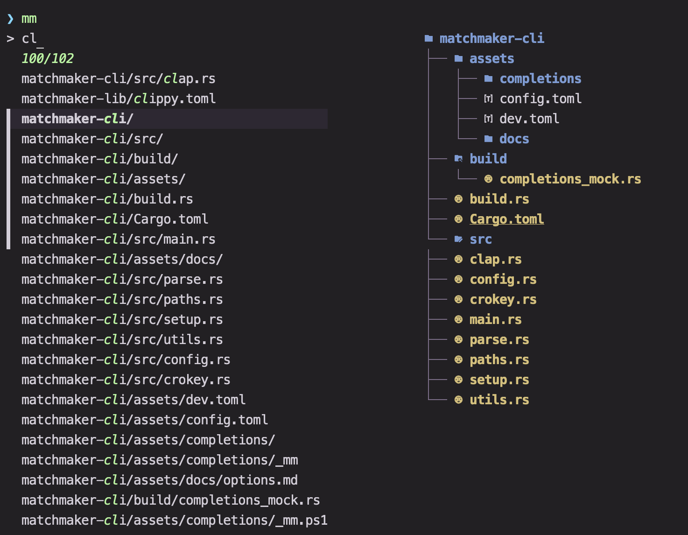

  <h1 class="linear-hero-title">Matchmaker</h1>
  

    <strong>Matchmaker</strong> (<code>mm</code>) is a fast, configurable, and intuitive fuzzy searcher for the terminal. Pipe lines or tables in, filter them with fuzzy matching, and print the selections back out: it doesn't sound like much, yet you'd be surprised how often that pattern comes up. Matchmaker is built to get the most out of it, prioritizing configurability and extensibility so complex workflows stay clean and modular. Alongside <a href="https://github.com/Squirreljetpack/matchmaker">too many features to list</a>, it comes with a unique help system, hand-tuned defaults, and a gallery of presets to try. Both the UI and matching stay fast and light on resources, with <a href="./benchmarks">benchmarks</a> to back it up.
  

  

    <a href="./getting-started" class="linear-chip">
      <svg viewBox="0 0 24 24" fill="none" stroke="currentColor" stroke-width="2"><polyline points="13 17 18 12 13 7"/><polyline points="6 17 11 12 6 7"/></svg>
      Getting started
    </a>
    <a href="./using-presets" class="linear-chip">
      <svg viewBox="0 0 24 24" fill="none" stroke="currentColor" stroke-width="2"><circle cx="12" cy="12" r="10"/><polyline points="12 6 12 12 16 14"/></svg>
      Using presets
    </a>
    <a href="./options" class="linear-chip">
      <svg viewBox="0 0 24 24" fill="none" stroke="currentColor" stroke-width="2"><path d="M14 2H6a2 2 0 0 0-2 2v16a2 2 0 0 0 2 2h12a2 2 0 0 0 2-2V8z"/><polyline points="14 2 14 8 20 8"/></svg>
      Options
    </a>
    <a href="./binds" class="linear-chip">
      <svg viewBox="0 0 24 24" fill="none" stroke="currentColor" stroke-width="2"><polyline points="4 6 20 6"/><line x1="4" y1="12" x2="20" y2="12"/><polyline points="4 18 20 18"/></svg>
      Binds
    </a>
  

  

    

      

        <svg viewBox="0 0 24 24" fill="none" stroke="currentColor" stroke-width="2" stroke-linecap="round" stroke-linejoin="round"><path d="M4 4h16v16H4z"/><polyline points="9 8 15 12 9 16"/></svg>
      

      <h3 class="linear-section-title">Getting started</h3>
    

    
Install Matchmaker, launch built-in presets, and author your own.

    <ul class="linear-link-list">
      <li class="linear-link-item">
        <a href="./getting-started">
          Getting started
          →
        </a>
      </li>
      <li class="linear-link-item">
        <a href="./using-presets">
          Using presets
          →
        </a>
      </li>
      <li class="linear-link-item">
        <a href="./creating-presets">
          Creating presets
          →
        </a>
      </li>
    </ul>
  

  

    

      

        <svg viewBox="0 0 24 24" fill="none" stroke="currentColor" stroke-width="2" stroke-linecap="round" stroke-linejoin="round"><rect x="3" y="3" width="18" height="18" rx="2" ry="2"/><line x1="3" y1="9" x2="21" y2="9"/></svg>
      

      <h3 class="linear-section-title">Interface</h3>
    

    
Input sources, interactive queries and columns, and the preview pane.

    <ul class="linear-link-list">
      <li class="linear-link-item">
        <a href="./input-and-data">
          Input and data sources
          →
        </a>
      </li>
      <li class="linear-link-item">
        <a href="./queries">
          Queries
          →
        </a>
      </li>
      <li class="linear-link-item">
        <a href="./preview">
          Preview
          →
        </a>
      </li>
    </ul>
  

  

    

      

        <svg viewBox="0 0 24 24" fill="none" stroke="currentColor" stroke-width="2" stroke-linecap="round" stroke-linejoin="round"><path d="M14 2H6a2 2 0 0 0-2 2v16a2 2 0 0 0 2 2h12a2 2 0 0 0 2-2V8z"/><polyline points="14 2 14 8 20 8"/></svg>
      

      <h3 class="linear-section-title">Reference</h3>
    

    
The built-in documentation from <code>mm --doc</code>.

    <ul class="linear-link-list">
      <li class="linear-link-item">
        <a href="./options">
          Options
          →
        </a>
      </li>
      <li class="linear-link-item">
        <a href="./binds">
          Binds
          →
        </a>
      </li>
      <li class="linear-link-item">
        <a href="./template">
          Template
          →
        </a>
      </li>
      <li class="linear-link-item">
        <a href="./pager">
          Pager
          →
        </a>
      </li>
      <li class="linear-link-item">
        <a href="./image">
          Image
          →
        </a>
      </li>
      <li class="linear-link-item">
        <a href="./execute">
          Execute
          →
        </a>
      </li>
      <li class="linear-link-item">
        <a href="./other">
          Other
          →
        </a>
      </li>
    </ul>
  

  

    

      

        <svg viewBox="0 0 24 24" fill="none" stroke="currentColor" stroke-width="2" stroke-linecap="round" stroke-linejoin="round"><polyline points="4 17 10 11 4 5"/><line x1="12" y1="19" x2="20" y2="19"/></svg>
      

      <h3 class="linear-section-title">Library</h3>
    

    
Embed Matchmaker in Rust applications and inspect built-in actions.

    <ul class="linear-link-list">
      <li class="linear-link-item">
        <a href="./library">
          Using the library
          →
        </a>
      </li>
      <li class="linear-link-item">
        <a href="./library-actions">
          Library actions
          →
        </a>
      </li>
    </ul>
  

