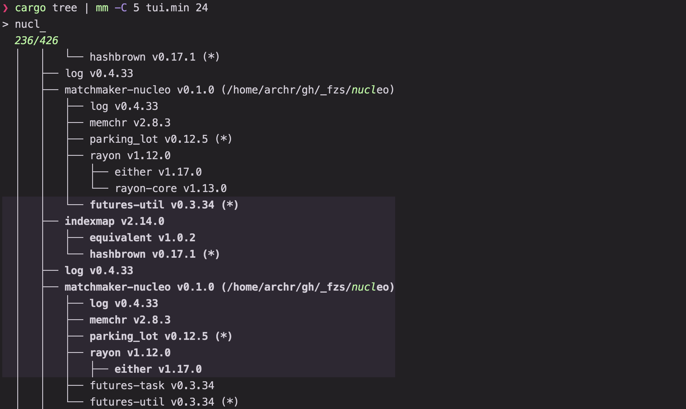
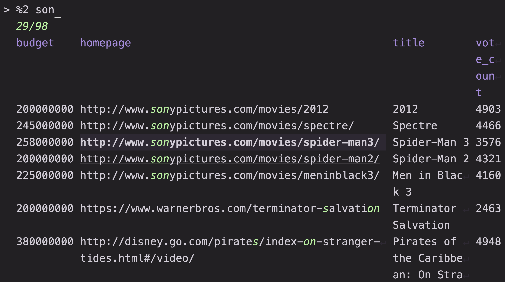

# Input and data sources

Matchmaker reads candidate rows either from standard input or from a configured populating command, then segments each record into searchable columns and optional header lines as the stream arrives.

## Feeding rows

How `mm` acquires input depends on whether standard input is connected to a terminal:

- **Piped standard input**: When `stdin` is a pipe or redirected file, `mm` reads records directly from `stdin` and ignores `start.command`.
- **Populating command (`start.command`)**: When `stdin` is a terminal, `mm` spawns `start.command` (CLI alias `x` or `cmd`). In `--dump-config`, this defaults to `fd --strip-cwd-prefix --print0` (falling back to `find . -print0`) with a NUL record separator.
- **Forcing the command (`--no-read`)**: Passing `--no-read` ignores a piped `stdin` and runs `start.command` anyway, which is useful when invoking `mm` inside a script or subshell whose standard input is already redirected.
- **Synchronous startup (`start.sync`)**: By default, rows stream in asynchronously while the interface is interactive. Setting `start.sync = true` (`s.sync=true`) waits for the input stream to finish before opening the picker.

`start.command` accepts a shell script, a preset script file (`@file` or `@./file`), or a Lua script (`#!lua` or `@file.lua`) that pushes rows through `inject(line)`. See [Execute](/execute) for command strategies and [Options](/options) for all `[start]` settings.

```shell
# Pipe rows from stdin
git branch --all | mm

# Override the populating command on the CLI
mm x "rg --files"

# Run start.command even when stdin is not a terminal
mm --no-read -o git < /dev/null
```

### Passing arguments after `--`

Arguments placed after `--` on the command line are forwarded directly to `start.command` (and to subsequent reloads) as positional arguments:

```shell
mm -o rg -- --hidden -g "*.rs"
```

When reading from a pipe without `--no-read`, trailing arguments after `--` are ignored with a warning. Inside preview commands, bound actions, and output templates, you can also expand trailing arguments with `{$1}`, `{$2}`, or `{$0}` for the full argument list; see [Template](/template).

### Record separators and context windows

By default, `mm` splits incoming streams on newline characters (`\n`). Set `start.input_separator` (CLI alias `n`) to split on another byte such as NUL (`mm n '\0'`), or set `separator` inside the `[start.command]` table so the custom separator applies only to the populating command and not to piped `stdin`:

```toml
[start.command]
command = "fd --strip-cwd-prefix --print0"
separator = "\\0"
```

Passing `-C <N>` rolls `2N + 1` consecutive input records into each item as a sliding window joined with newlines. Once the first `2N + 1` lines fill the window, each subsequent line emits a new multi-line item and drops the oldest line; streams shorter than `2N + 1` lines flush as a single item when the stream ends.

```shell
# Group each line with 1 line of surrounding context above and below (3 lines per row)
rg --line-number "TODO" | mm -C 1
```



## Reloading and cycling sources

You can repopulate the picker in place without exiting the TUI:

| Action / setting | Role |
| --- | --- |
| `Reload` | Rerun of the active populating command (`ctrl-r` via `@reload` in `--dump-config`) |
| `Reload(cmd)` | Replacement of the active populating command with `cmd` and immediate reload |
| `start.additional_commands` | List of commands (`s.ax`) available to `ReloadNext` and `ReloadPrev` |
| `ReloadNext` / `ReloadNext(n)` | Forward step through `additional_commands`, or jump to 0-based command index `n` |
| `ReloadPrev` | Backward step through `additional_commands` |
| `results.delay_clear` | Retention of previous rows on screen until the reloaded command produces output (`true` in `--dump-config`) |

When `start.additional_commands` is non-empty, `mm` seeds `@next` (`["ReloadNext", "ClearQuery"]`) and `@prev` (`["ReloadPrev", "ClearQuery"]`), bound to `alt-]` / `ctrl-shift-n` and `alt-[` / `ctrl-shift-p` (`--dump-config`). If the first element of `additional_commands` is an empty string (`""`), `mm` replaces it with `start.command` so the initial command is included in the rotation:

```toml
[start]
command = "ps -eo pgid,pid,user,%cpu,vsz,rss,etime,stat,command"
additional_commands = [
    "",
    "lsof -nP -i",
]
```

Each reload clears active multi-selections, kills the previous populating process (unless `start.save_orphans = true`), emits the `Reloaded` lifecycle event, and exports `MM_INDEX` with the 0-based index of the active command in `additional_commands`. Setting `_MM_INDEX` in the environment before launching `mm` selects which entry in `additional_commands` runs first. See [Binds](/binds) for lifecycle events and semantic triggers.

## Splitting rows into columns

Before rows are indexed by the matcher, `columns.split` (CLI alias `d`) divides each line into columns. When `matcher.ansi = true` (CLI alias `a`), ANSI escape codes are stripped before splitting so color sequences never shift column boundaries, while the rendered table preserves the original styling.

| `columns.split` value | Segmentation behavior |
| --- | --- |
| `null` (default) | Single column spanning the entire row |
| `"<regex>"` (no capture groups) | Delimiter split between matches up to `columns.max`, merging any remainder into the final column |
| `"<regex>"` (unnamed capture groups) | Capture-group extraction mapping each `(group)` to a column in order |
| `"<regex>"` (named capture groups) | Named extraction mapping each `(?P<name>...)` group to the matching entry in `columns.names` |
| `["<re1>", "<re2>"]` | Sequential regex list matching each pattern from the end of the previous match |
| `"csv"` / `"tsv"` | RFC 4180 comma- or tab-separated fields with unquoted ranges and `""` quote escaping |

When `columns.names` (`c.n`) is omitted, `mm` generates up to `columns.max` columns (default `6`, clamped to `1`–`16`) named `1`, `2`, and so on. Providing `columns.names` assigns explicit alphanumeric names and per-column flags (`hidden`, `ignore`, `options`). `columns.default` (`c.i`) selects the primary column by name or 1-based index.

To discard malformed or header-only lines during ingestion, set `matcher.require_column` to a 0-based column index; any row where that column is empty or fails to match the split regex is skipped before indexing. See [Queries](/queries) for searching and navigating columns and [Options](/options) for `[columns]` and `[matcher]` configuration.

## Headers, footers, and prompt context

Header and footer rows frame the results list with column labels, key hints, or active mode indicators:

- **Streamed header rows (`header.header_lines`, alias `h.h`)**: Consumes the first `N` records from the input stream (and on every `Reload`) before they enter the matcher, splits them with the active `columns.split` rules, and pins them above the results aligned to the table's column widths.
- **Static header and footer content (`header.content` / `h`, `footer.content`)**: Accepts a single string (drawn across the full pane width) or an array of strings (drawn as individual column cells aligned with the results table).
- **Runtime updates**: Actions such as `SetHeader`, `PushHeader`, `SetFooter`, `PushFooter`, `SetPrompt`, `SetStyledPrompt`, `SetStatus`, and `SetStyledStatus` update UI chrome dynamically from keybindings or `Reloaded` / `QueryChange` event hooks. See [Template](/template) for status and prompt styling syntax and clickable interaction regions.

```shell
# Split on runs of spaces, pin the first input line as the table header, and focus column 9
ls -l | mm d " +" c.max=9 c.i=9 h.h=1
```


