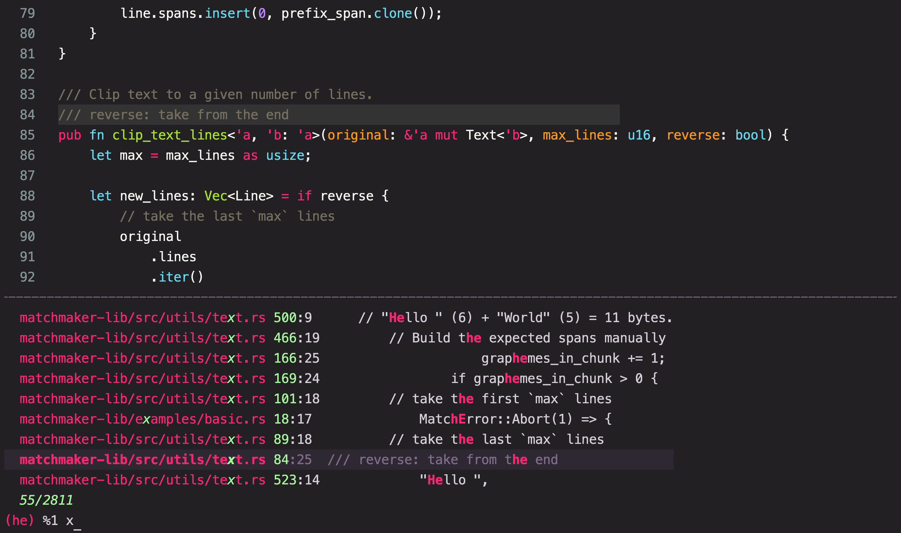

# Preview

The preview pane runs shell commands formatted against the highlighted row—or displays static text, keybinding help, or images—alongside the results table, updating asynchronously as you move the cursor.

## Preview layouts and cycling

Preview geometry and commands are configured through one or more `[[preview.layout]]` blocks (CLI alias `p.l` or `P`, with `px` as a shortcut for `preview.layout.command`). Defining multiple layouts lets you cycle between different pane positions, sizes, or inspection commands at runtime:

```toml
[preview]
wrap = true
scroll_wrap = true

[[preview.layout]]
command = "bat --color=always --style=-numbers -- {1}"
side = "right"
percentage = 40
min = 30
max = 120

[[preview.layout]]
side = "top"
percentage = 55
min = 5
max = 50

[[preview.layout]]
side = "right"
percentage = 75
min = 5
max = 240
```

- **Command inheritance**: A `[[preview.layout]]` entry that omits `command` keeps the command already active in the preview state, so extra layouts can reposition or resize the pane without re-specifying the script.
- **Per-layout overrides**: Each layout entry can set `side` (`right`, `left`, `top`, `bottom`), `percentage`, `min`, `max` (`max = 0` disables the layout), plus per-layout `frame` and `initial` scroll settings layered over `[preview.frame]` and `[preview.initial]`.
- **Visibility threshold (`preview.show`)**: Accepts `true`, `false`, or a minimum cell count that the terminal's width (`left`/`right`) or height (`top`/`bottom`) must reach before the preview opens (see [Options](/options)).
- **Preview environment**: Preview commands run under `previewer.shell` (defaulting to `$SHELL -c`) with `{}` template placeholders expanded ([Template](/template#preview-environment)).

| Action | Default keys | Effect |
| --- | --- | --- |
| `SwitchPreview` | `?` | Toggles the preview pane |
| `NextPreview` | `alt-/` | Cycles to the next enabled layout (`max > 0`) |
| `PrevPreview` | `alt-shift-/` | Cycles to the previous enabled layout |

See [Binds](/binds#preview) for direct layout actions (`SwitchPreview(idx)`, `SetPreview`).

## Resizing and dragging

You can adjust the preview split at runtime with the keyboard or the mouse:

- **Keyboard resizing (`ExpandPreview`, `ShrinkPreview`)**: `ExpandPreview(n)` (`alt-shift-=` / `alt-+`) and `ShrinkPreview(n)` (`alt-shift-hyphen`) grow or shrink the preview pane's width (for `left`/`right` layouts) or height (for `top`/`bottom` layouts) by `n` cells (default `1`). Passing `0` (`ExpandPreview(0)` or `ShrinkPreview(0)`) clears the manual size override and returns to the active layout's `percentage`, `min`, and `max` rules. Cycling or switching layouts also resets any manual size override.
- **Mouse dragging (`preview.drag_width`)**: Dragging the divider edge between the results pane and the preview pane resizes the preview with the cursor. By default, the draggable strip width equals the preview frame's border and padding width on the shared edge; set `preview.drag_width` to an explicit cell width, or `0` to disable drag resizing.

## Scrolling, sticky headers, and jumping

`[preview.initial]` (CLI alias `p.i`, or `scroll` in TOML) controls where the preview viewport starts when a new item is selected and how many header lines stay pinned at the top:

- **Target line extraction (`index`, `offset`, `percentage`)**: Setting `initial.index` to a column name or 0-based column index parses a line number from that column and scrolls the preview so the target line sits `initial.percentage` (0–100) from the bottom of the pane. `initial.offset` shifts the target line and defaults to `-1` when `index` is set so 1-indexed line numbers (such as `rg --line-number` output) land on the exact match.
- **Sticky headers (`initial.header_lines`, alias `h`)**: Keeps the first `N` lines of preview output fixed at the top of the pane while the remaining body lines scroll underneath.
- **Tail mode (`initial.tail`, alias `t`)**: Starts the preview scrolled to the bottom of the output (while still keeping any `header_lines` pinned at the top).

```toml
[preview]
show = true
scroll.index = "pos"
scroll.percentage = 70
```



Inside the TUI, preview scrolling and wrapping are controlled independently from the results table:

| Action | Default keys | Effect |
| --- | --- | --- |
| `PreviewUp(n)` / `PreviewDown(n)` | Mouse wheel on preview | Vertical scroll by `n` lines (default `1`) |
| `PreviewHalfPageUp` | `shift-pageup` | Upward scroll by half the preview pane height |
| `PreviewHalfPageDown` | `shift-pagedown` | Downward scroll by half the preview pane height |
| `PreviewJump` | `ctrl-j`, `shift-home`, `shift-end` | Three-way jump between end of output, top (`0`), and previous scroll offset |
| `TogglePreviewWrap` | `alt-shift-w` | Line-wrapping toggle in the preview pane (`preview.wrap`) |

`PreviewScroll(n)` and `PreviewHScroll(n)` (see [Binds](/binds#preview)) provide persistent line/cell scrolling and image zoom/pan. When `preview.scroll_wrap = true` (`p.c`), scrolling past the first or last line wraps around to the opposite end.

## Ad-hoc commands and fullscreen paging

Beyond the commands configured in `[[preview.layout]]`, several actions let you swap preview content on the fly or inspect long output fullscreen:

- **`Preview(cmd)`**: Replaces the active preview command template with `cmd` and opens the preview pane; triggering `Preview(cmd)` again with the same template toggles the preview closed.
- **`RunPreview(cmd)`**: Runs a one-off command and displays its output in the preview pane until the selection moves or `SetPreview` restores the layout command. Calling bare `RunPreview` with no argument (default `ctrl-shift-l`) executes the current preview command in the foreground terminal and returns to the picker.
- **`Help` (`alt-h`) and `@help` (`F1`)**: `Help` toggles a live keybinding summary inside the preview pane. `@help` pages the active preset's `README.md` (or leading `#` comment header) followed by the resolved keybindings fullscreen in the pager.
- **`ShowPreview([cmd])` (`ctrl-l`, `F11`)**: Streams the current preview command (or `cmd` when given) into the fullscreen interactive pager without polluting redirected `stdout`, and resumes the picker when you exit the pager with `q`. See [Pager](/pager) for `pager.toml` options, external pager fallback (`MM_PAGER` -> `$PAGER` -> `less` -> `more`), and pager keybindings.

## Image previews

When `previewer.images` is enabled (the default) and a preview command's output begins with an `<MM_IMAGE>` header—produced by `mm -q pager -- {1}` or `mm -q image -- {1} && exit 0`—Matchmaker renders the image directly inside the preview pane using the terminal's graphics protocol (`kitty`, `sixel`, `iterm2`, or `halfblocks` fallback under `preview.image.protocol = "auto"`).

```shell
mm -q image -- {1} && exit 0
bat --color=always --style=-numbers -- {1}
```

Any text written after the image payload is displayed in the same preview pane: the first `preview.image.header_lines` lines are drawn above the image, and the remaining lines scroll beneath it. While an image is visible in the pane, `PreviewScroll(n)` zooms the image in `0.1x` increments (floored at `1.0x`), `PreviewHScroll(n)` pans horizontally, and `PreviewUp` / `PreviewDown` pan vertically before scrolling into the text below. See [Image](/image) for `mm image` options, header syntax, and `[preview.image]` fitting rules.
